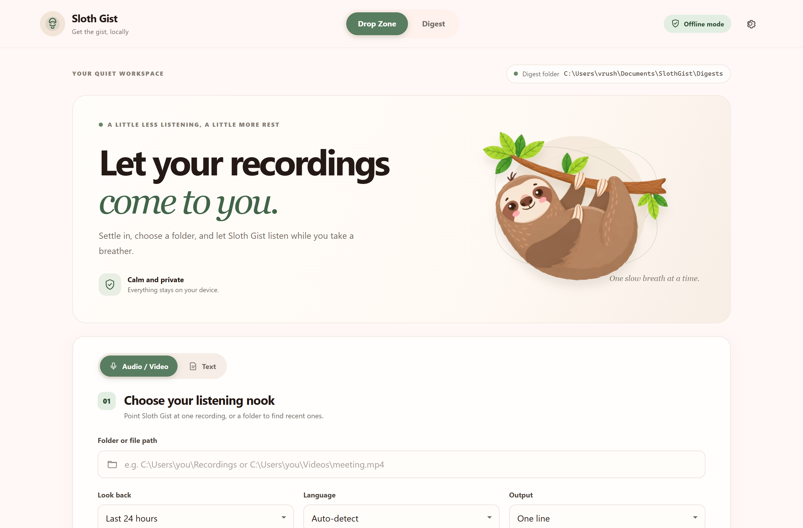
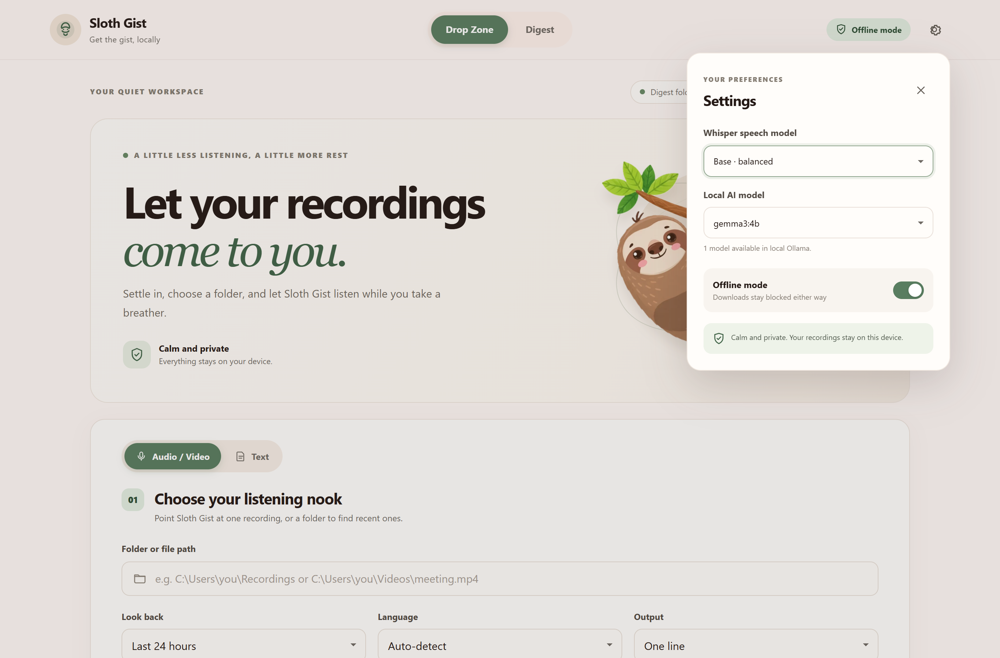
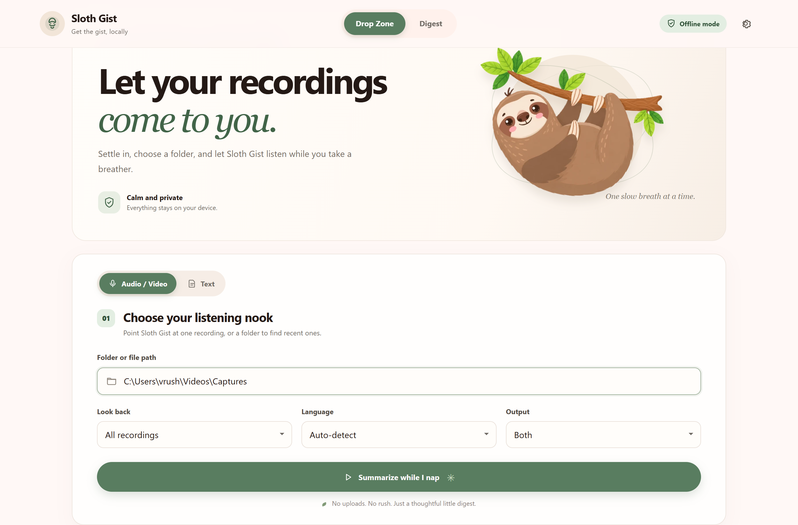
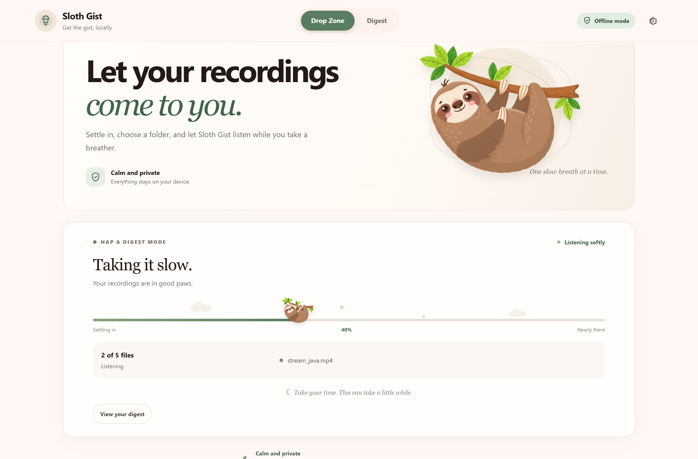
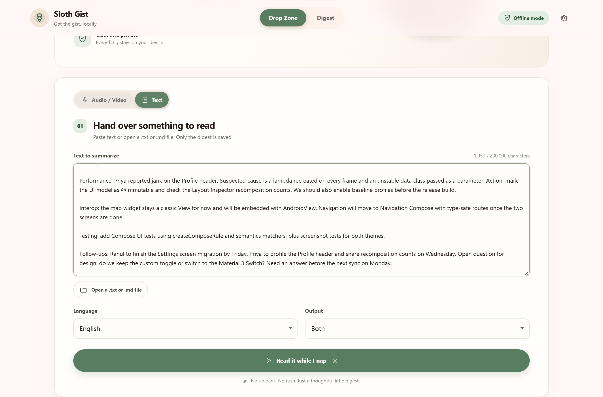
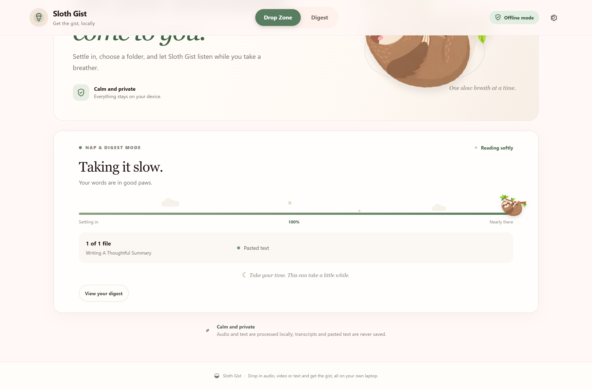
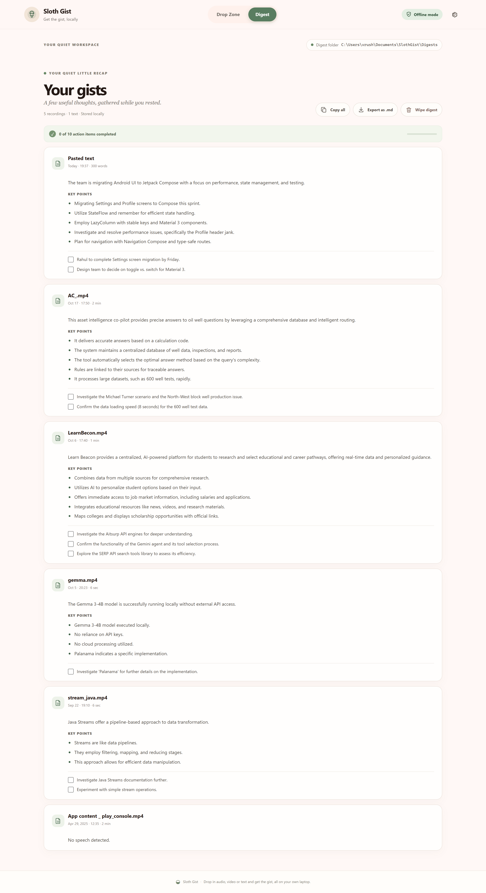

# Sloth Gist demo flow 🦥

A walk through one session: summarize a folder of screen recordings, then a
pasted meeting note, and read both in the digest. Everything ran on one laptop
with `gemma3:4b` in Ollama and the Whisper `base` model.

## 1. Open the Drop Zone

Start the server with `python -m sloth_gist.server` and open
<http://127.0.0.1:8765>. The Drop Zone has two tabs: **Audio / Video** and
**Text**.

## 2. Pick the models

The gear icon opens **Settings**. The Whisper menu lists only the sizes that
are already downloaded, and the AI model menu lists what local Ollama has.
Downloads stay blocked while the app runs.

## 3. Point it at a folder of recordings

Paste a folder or file path. Here it is a folder of five short screen
recordings (`.mp4`). **Look back** is set to *All recordings* and **Output**
to *Both* (a summary line plus key points). Then press
**Summarize while I nap**.

## 4. Let the sloth work

Each video's soundtrack is transcribed and then summarized. The sloth moves
along the progress bar as files finish. Transcripts stay in memory and are
never saved.

## 5. Paste some text

Switch to the **Text** tab and paste notes, an article or a chat export (up to
200,000 characters), or open a `.txt` / `.md` file. This example is a Jetpack
Compose migration meeting note. The language is set to English and the output
to *Both*. Press **Read it while I nap**.

## 6. Text runs without Whisper

Text goes straight to the local model, so it finishes in seconds.

## 7. Read the digest

The **Digest** tab shows every gist, newest first. Each card has a one-line
summary, key points and a to-do checklist. **Copy all**, **Export as .md** and
**Wipe digest** are at the top.

The Compose note became five key points and two to-dos (Rahul's Friday
deadline and the open design question). One follow-up, Priya's Wednesday task,
was missed, which is a typical small-model slip. The `App content` recording
shows *No speech detected* because Whisper found no speech in it.

